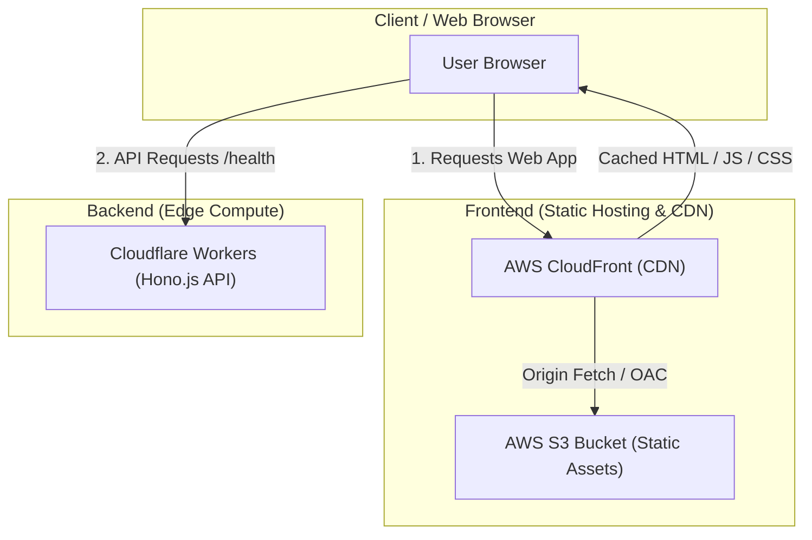

# 🌐 Cloud Deployment Architecture

A modern, high-performance full-stack cloud deployment architecture leveraging edge computing and global content delivery:
- **Frontend**: Single Page Application (SPA) built with **React** and **Vite**, hosted on **AWS S3** and distributed worldwide via **AWS CloudFront**.
- **Backend**: Ultra-fast, lightweight API service powered by **Hono.js**, running on **Cloudflare Workers** edge infrastructure.

---

## 🏗️ Architecture Overview



### Key Architectural Benefits
- **Zero Server Management**: Both frontend and backend are completely serverless.
- **Ultra-Low Latency**: CloudFront caches frontend assets across global edge locations; Cloudflare Workers executes Hono API logic close to users worldwide.
- **Cost Efficiency**: High scalability with minimal idle costs, paying only for actual requests and bandwidth.

---

## 📁 Repository Structure

```text
cloud_deployment/
├── aws-s3-deployment/          # Frontend: React + Vite application
│   ├── dist/                   # Compiled production build artifacts
│   ├── src/                    # React components, styles, and assets
│   ├── index.html              # HTML entry point
│   ├── package.json            # Frontend dependencies & build scripts
│   └── vite.config.js          # Vite configuration
│
└── hono.js--cloudflare/        # Backend: Hono.js edge API
    ├── src/
    │   └── index.ts            # Hono application & route definitions
    ├── package.json            # Hono & Wrangler dependencies
    ├── tsconfig.json           # TypeScript configuration
    └── wrangler.jsonc          # Cloudflare Workers configuration
```

---

## 🚀 Projects Breakdown

### 1. Frontend (`aws-s3-deployment`)

A modern React 19 application bundled with Vite for fast local development and optimized production builds.

- **Stack**: React 19, Vite, Vanilla CSS
- **Path**: [`aws-s3-deployment`](file:///c:/Users/Abhinay%20Mhatre/Projects/practice_projects/hono.js/aws-s3-deployment)

#### Local Development
```bash
cd aws-s3-deployment
npm install
npm run dev
```

#### Build for Production
```bash
npm run build
```
This generates static files inside the `dist/` directory ready for deployment.

#### Deployment to AWS S3 & CloudFront
1. **S3 Bucket Configuration**:
   - Create an S3 bucket (e.g., `my-vite-app-bucket`).
   - Enable static website hosting or use **Origin Access Control (OAC)** to restrict access exclusively to CloudFront.
2. **Upload Build Files**:
   ```bash
   aws s3 sync dist/ s3://<your-s3-bucket-name> --delete
   ```
3. **AWS CloudFront Distribution**:
   - Set the distribution origin to the S3 bucket.
   - Configure **Default Root Object** to `index.html`.
   - Setup custom error response for SPA routing:
     - **HTTP Error Code**: `403: Forbidden` or `404: Not Found`
     - **Response Page Path**: `/index.html`
     - **HTTP Response Code**: `200: OK`
4. **Invalidate Cache (on updates)**:
   ```bash
   aws cloudfront create-invalidation --distribution-id <YOUR_DISTRIBUTION_ID> --paths "/*"
   ```

---

### 2. Backend API (`hono.js--cloudflare`)

A lightweight, blazing-fast REST API built with Hono.js and deployed to Cloudflare Workers.

- **Stack**: Hono.js, TypeScript, Cloudflare Workers, Wrangler
- **Path**: [`hono.js--cloudflare`](file:///c:/Users/Abhinay%20Mhatre/Projects/practice_projects/hono.js/hono.js--cloudflare)

#### Local Development
```bash
cd hono.js--cloudflare
npm install
npm run dev
```

#### API Endpoints
| Method | Path | Description | Response |
| :--- | :--- | :--- | :--- |
| `GET` | `/health` | Healthcheck endpoint | `{"message": "healthy", "success": true}` |

#### Cloudflare Deployment
1. **Authenticate Wrangler**:
   ```bash
   npx wrangler login
   ```
2. **Deploy to Cloudflare Workers**:
   ```bash
   npm run deploy
   ```
3. **Synchronize Cloudflare Types**:
   ```bash
   npm run cf-typegen
   ```

---

## ⚙️ Prerequisites

- **Node.js**: `v18.x` or higher
- **Package Manager**: `npm` / `pnpm`
- **AWS CLI**: Configured with appropriate S3 and CloudFront IAM permissions
- **Wrangler CLI**: Cloudflare Workers command-line interface

---

## 🔮 Next Steps & Best Practices

- [ ] **Cross-Origin Resource Sharing (CORS)**: Add `cors()` middleware in Hono to allow requests from the CloudFront domain.
- [ ] **CI/CD Automation**: Implement GitHub Actions to automate:
  - Building and deploying the frontend to S3 + invalidating CloudFront cache.
  - Deploying the Hono Worker on pushes to `main`.
- [ ] **Custom Domain & SSL**: Attach custom domain names (via Cloudflare DNS or AWS Route 53) with ACM/Cloudflare SSL certificates.
